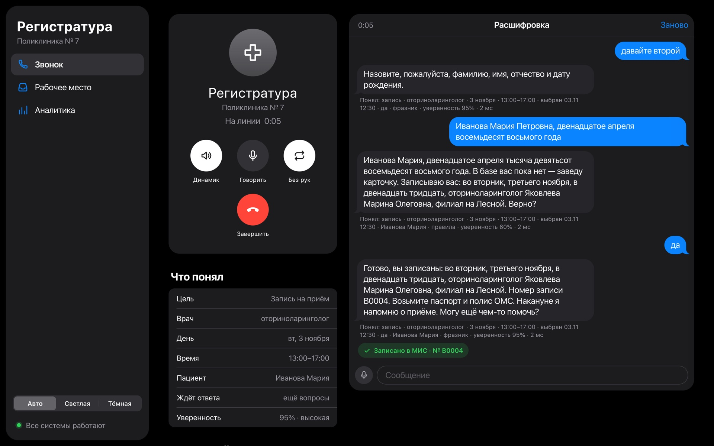
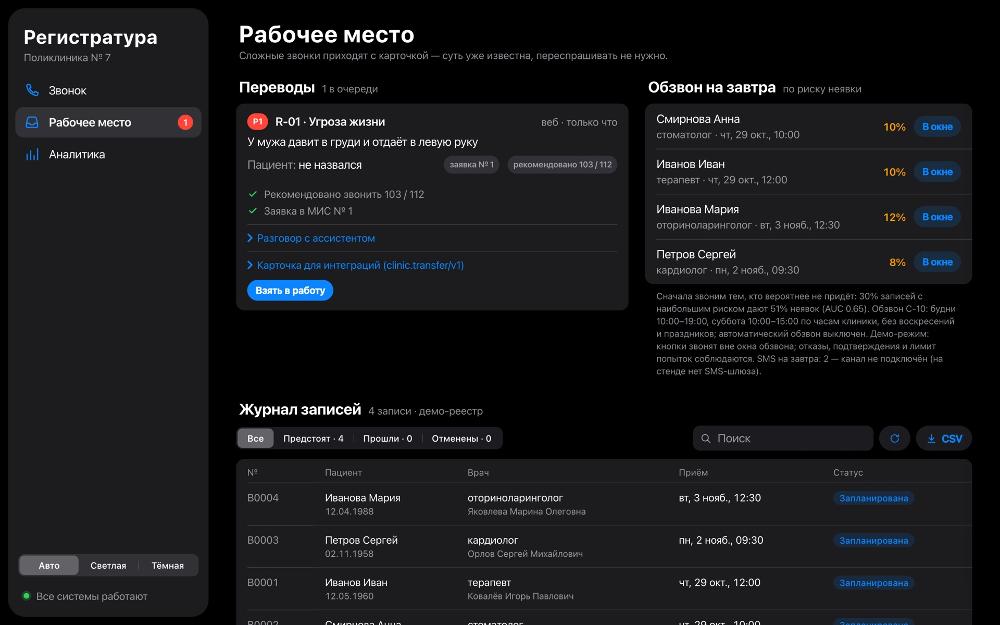
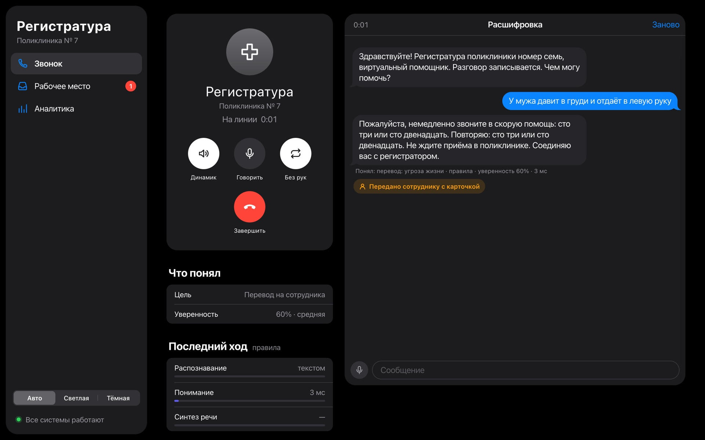
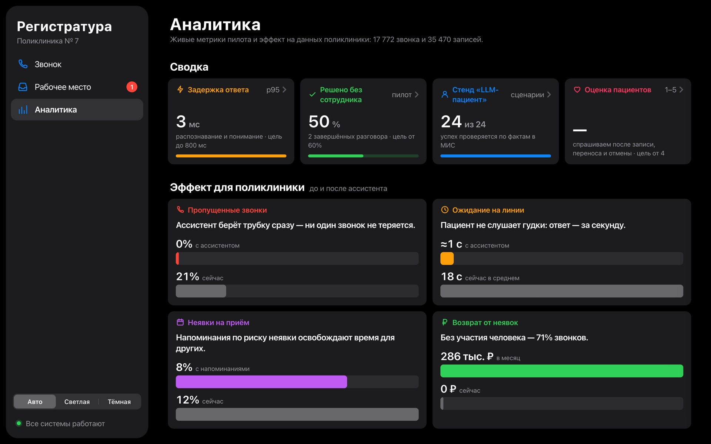
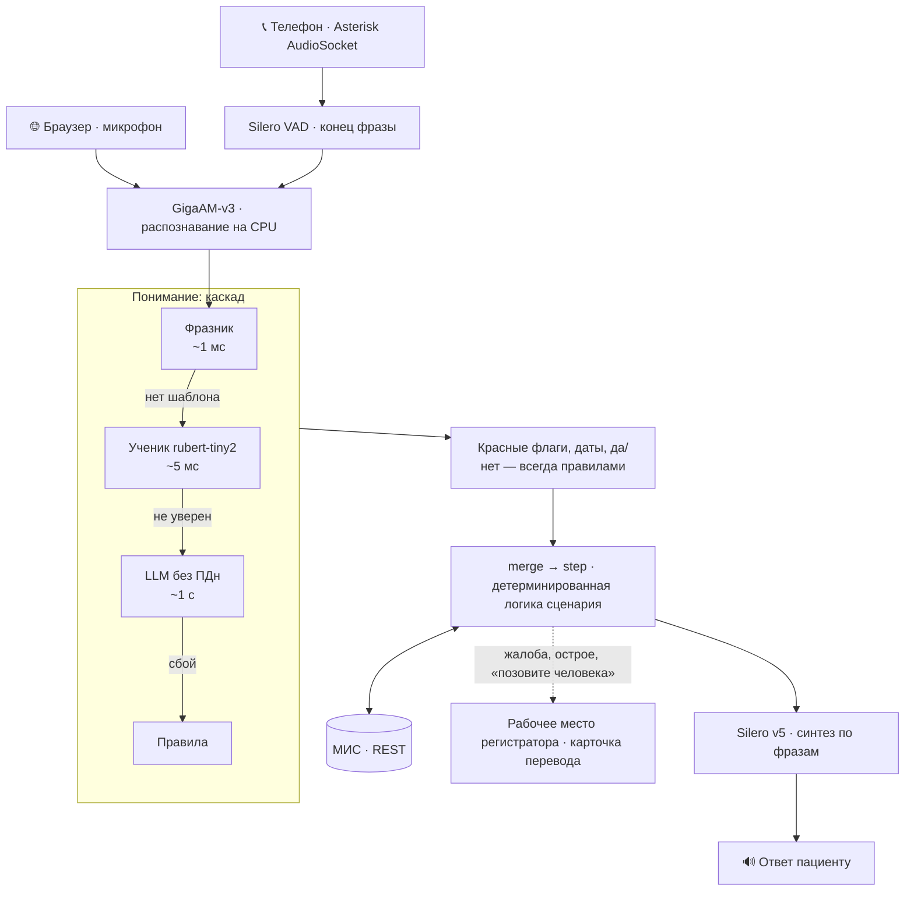

<div align="center">

# Голосовой ассистент регистратуры

**Берёт трубку вместо перегруженной регистратуры поликлиники и доводит звонок до записи в медицинской информационной системе (МИС).**
Работает по телефону и в браузере. Понимает свободную русскую речь и не выдумывает врачей и время приёма. Сложные звонки передаёт человеку.




</div>

## Что умеет

- 📅 **Запись на приём.** Понимает фразы вроде «мне бы к лору во вторник после обеда» или «к Беловой» и предлагает три свободных времени из расписания. Новому пациенту повторяет ФИО и дату рождения и записывает только после «да».
- 🔁 **Перенос, отмена и статус записи.** Работает только после идентификации по ФИО и дате рождения. Отмену подтверждает отдельно, а перед ней один раз предлагает перенос.
- 📞 **Напоминание накануне визита.** Ассистент сам звонит пациенту. Если тот отвечает «не смогу», сразу предлагает перенос. Порядок обзвона задаёт модель риска неявки.
- 🚑 **Красные флаги.** На фразы вроде «давит в груди» сразу отвечает «звоните 103 или 112», ни о чём не спрашивая. Жалобы и просьбы «позовите человека» переводит регистратору с готовой карточкой.
- ℹ️ **38 справочных тем:** режим работы, адрес, цены, документы, сроки анализов, вызов врача на дом.
- 🩺 **Без медицинских советов.** Диагнозы не ставит и лекарства не советует: на такие вопросы предлагает записаться к врачу.

| Рабочее место регистратора | Красный флаг | Аналитика |
| :---: | :---: | :---: |
|  |  |  |

## Как это устроено

Архитектура называется **«управляемый агент»**. Модель только переводит фразу пациента в поля: цель, врач, день, время, ФИО. Всё остальное решает обычный детерминированный код:
- какого врача и какое время предложить;
- что изменить в МИС;
- что ответить пациенту.

Поэтому ассистент не может выдумать врача, свободное время или номер записи.



| Слой | Что используется | Когда включается |
| :--- | :--- | :--- |
| Конец фразы | Silero VAD и таймер тишины: 0,8 с, а после вопроса «да/нет» 0,45 с | каждый звук |
| Распознавание | GigaAM-v3 на CPU, звук не покидает машину | каждая фраза |
| Фразник | 32 тыс. шаблонов в хэш-таблице: «мне бы к {spec} на {day}» | первым |
| Ученик | `rubert-tiny2`, дистиллированный из LLM на корпусе в 2 192 реплики | если в фразнике нет шаблона |
| LLM | любой OpenAI-совместимый шлюз (GigaChat, vLLM, Ollama), ответ в JSON по схеме Pydantic | если ученик не уверен (~30% реплик) |
| Правила | регулярные выражения и словари | всегда: красные флаги, даты, «да/нет»; при сбое LLM — вместо неё |
| Синтез | Silero v5 (запасной — Piper), по фразам: первая звучит, пока синтезируются следующие | каждый ответ |

Подробнее — в [docs/02_architecture.md](docs/02_architecture.md), почему так — в [журнале решений](docs/04_decisions.md).

## Цифры

| Что | Результат | Как проверить |
| :--- | :--- | :--- |
| От конца фразы пациента до голоса ассистента | **≈0,94 с**, после «да/нет» ≈0,63 с | `tools/latency_bench.py` → [latency.json](eval/results/latency.json) |
| «LLM играет пациента»: 24 персоны, итог проверяется по фактам в реестре | **24 из 24**, выдуманных слотов 0 | `python -m eval.simulate` → [eval/report.md](eval/report.md) |
| Ошибки распознавания (WER) на телефонном звуке 8 кГц | **7,1%** у GigaAM против 13,1% у Whisper | `tools/stt_bench.py` → [stt_bench.json](eval/results/stt_bench.json) |
| Фразы, понятые без LLM | 55% фраз отложенного набора, точность 94% | `tools/eval_cascade.py` → [cascade_eval.json](eval/results/cascade_eval.json) |
| Перебивание голосом | замолкает через ≈0,33 с, 0 ложных срабатываний на эхо | `tools/bargein_sim.mjs` → [bargein_sim.json](eval/results/bargein_sim.json) |
| Риск неявки | AUC 0,65: в 30% записей с наибольшим риском — 51% неявок | `tools/train_noshow.py` → [noshow_model.json](eval/results/noshow_model.json) |
| Тесты | 274, без сети | `make test` |

## Быстрый старт

Без ключей, без сети и без GPU:

```bash
make install && make test && make demo
```

`make demo` проводит 7 разговоров: запись, статус, перенос, отмена, справка, перевод при острой боли и напоминание. В конце сверяет итог в реестре и печатает «Итог: 7 из 7».

Веб-интерфейс:

```bash
make run    # http://localhost:8000
```

Режимы добавляются по мере готовности. Чего не хватает, заменяет запасной путь. `make doctor` показывает, что готово и как включить остальное.

| Режим | Что даёт | Что нужно |
| :--- | :--- | :--- |
| База | веб, фразник и правила, демо-реестр в SQLite | `make install` |
| LLM | понимание сложных фраз | `LLM_BASE_URL`, `LLM_API_KEY` в `.env` |
| Голос | GigaAM, Silero, Silero VAD на CPU | `make install-ml models` (~1,5 ГБ, один раз) |
| Ученик | локальная модель понимания, отвечает за 3–10 мс | `make student` (корпус пишет LLM) |
| МИС | записи во внешней МИС по REST | `DBI_API_URL`, `DBI_API_TOKEN`, расписание в `data/` |
| Телефония | входящие звонки, перевод на регистратора, обзвон | Asterisk и SIP-транк: [deploy/](deploy/) |

Есть и Docker: `docker compose up --build`. Все переменные окружения перечислены в [.env.example](.env.example).

## Надёжность и персональные данные

- **Fallback на каждом шаге** ([core/resilience.py](core/resilience.py)). У каждой внешней зависимости свой предохранитель: LLM, МИС, распознавание, синтез, Asterisk. Если LLM недоступна, понимают фразник и правила. Если недоступна МИС, звонок переводится регистратору с карточкой. Состояние зависимостей отдаёт `GET /api/health`.
- **ПДн не уходят во внешнюю LLM.** Реплики с ФИО и датой рождения разбираются только на машине. В остальном тексте имена, телефоны и полисы заменяются метками. Логи тоже маскируются.
- **Голос не покидает сервер.** Распознавание и синтез идут на CPU, облачного распознавания нет даже в резерве.
- **Любое изменение в МИС — только после явного «да».** Номер записи не заменяет идентификацию.

## Структура

```
core/           ядро агента: цикл, OpenAI-совместимый клиент LLM, guard, отказоустойчивость, русские числа словами
domains/clinic/ домен поликлиники: каскад понимания, merge/step, сценарии, МИС, расписание, справки, напоминания
apps/           веб (FastAPI + один HTML без сборки), телефония (AudioSocket, AMI), голос, журнал разговоров
eval/           «LLM играет пациента»: 24 персоны и проверка итога по фактам
tools/          замеры, обучение ученика и модели неявки, проверка готовности
deploy/         диалплан Asterisk и скрипт настройки
tests/          274 теста без сети
```

## О проекте

Проект сделан за три недели на продуктовом хакатоне «Точка сборки» (октябрь 2026) по кейсу DBI «Голосовой ассистент для записи в клинику». Команда «Искусственный прайм»: **Даниил Кокорев**, **Артемий Лунев**.

Все врачи, пациенты и записи в репозитории вымышленные. Материалы кейса (регламент, расписание, данные клиники) в репозиторий не входят. Использованные библиотеки и модели с лицензиями перечислены в [THIRD_PARTY.md](THIRD_PARTY.md).
