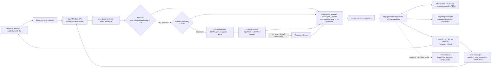

# 02. Архитектура и структура данных

## Схема



Главный принцип — **управляемый агент**. Модели (фразник, ученик, LLM) только понимают реплику: заполняют `ClinicUpdate`. Что ответить и что изменить в МИС, решает детерминированный код домена (`merge` + `step`). Ответ собирается по шаблонам регламента из данных МИС и расписания, поэтому ассистент не может выдумать врача, время, номер записи или цену.

## Модули

| Путь | Назначение |
| :--- | :--- |
| `core/config.py` | Настройки из `.env`: адрес, ключ и модель LLM, флаги |
| `core/llm.py` | OpenAI-совместимый клиент и `extract()`: JSON → Pydantic, одна попытка ремонта, пустая модель как fallback |
| `core/guard.py` | Очистка ввода, лимит длины, эвристика против промпт-инъекций |
| `core/agent.py` | Контракт `Domain`, `Session`, цикл `Agent.handle()` и каскад понимания |
| `core/ru.py` | Даты, время и числа словами для голоса |
| `domains/clinic/domain.py` | `ClinicDomain` — собирает три части ниже в один домен для `core.agent` |
| `domains/clinic/understanding.py` | Каскад понимания (фразник → ученик → LLM → правила), промпт, `postprocess` |
| `domains/clinic/dialog.py` | `merge`: ответы на вопросы «да/нет», справки, перевод, смена сценария |
| `domains/clinic/scenarios.py` | `step`: сценарии регламента (С-01…С-15), маршрутизация 7.3, работа с МИС |
| `domains/clinic/models.py`, `replies.py`, `offers.py` | `ClinicState` и `ClinicUpdate`; скрипты регламента и маршруты; варианты для голоса |
| `domains/clinic/phrasebook.py` | Фразник: шаблоны стандартных фраз → речевой акт |
| `domains/clinic/student.py`, `acts.py` | Модель-ученик (дистилляция LLM) и речевые акты |
| `domains/clinic/privacy.py` | Обезличивание реплик и истории перед внешней LLM (152-ФЗ) |
| `domains/clinic/rules.py`, `speech.py` | Разбор по правилам; нормализация транскриптов (паразиты, склейки, числа словами) |
| `domains/clinic/faq.py` | Справки раздела 6 регламента |
| `domains/clinic/mis.py` | Клиент стенда МИС и реестр клиники поверх него |
| `domains/clinic/schedule.py`, `timetable.py` | Врачи, слоты, записи; расписание кейса из CSV |
| `domains/clinic/noshow.py` | Риск неявки: логистическая регрессия на чистом Python |
| `apps/container.py` | Сборка приложения (composition root): конфигурация из окружения, выбор реестра (стенд МИС или SQLite), LLM, голос, журнал, телефония — модули друг друга не создают |
| `core/resilience.py` | Предохранители внешних зависимостей, запасные пути (`FALLBACKS`), маскирование ПДн в логах |
| `domains/clinic/store.py` | Демо-реестр на SQLite: записи, пациенты, заявки, итоги обзвона переживают перезапуск |
| `apps/web/` | FastAPI и интерфейс: звонок, рабочее место регистратора, аналитика — только HTTP-маршруты |
| `apps/telephony.py` | AudioSocket-сервер для Asterisk, исходящие напоминания через AMI |
| `apps/voice.py` | Распознавание (только GigaAM на машине) и синтез (Silero, Piper), поддакивания, Silero VAD |
| `apps/journal.py` | Журнал разговоров: карточки переводов, живая аналитика, хранение по 152-ФЗ |
| `apps/cli.py` | Консольный чат для ручной проверки |
| `eval/` | Стенд «LLM играет пациента», 23 сценария, проверка по фактам в МИС; набор фраз для оценки понимания |
| `tools/` | Импорт расписания, обучение ученика и модели неявок, аналитика по данным кейса, замеры |
| `deploy/` | Конфигурация Asterisk (входящие, напоминания, тёплый перевод на регистратора) и скрипт настройки на ВМ |
| `tests/` | Тесты без сети (`FakeLLM`, фейковый клиент МИС) |

## Структура данных

### Состояние диалога и разбор реплики (`domains/clinic/models.py`)

`ClinicUpdate` — что понимание извлекает из одной реплики. Все поля необязательны, `null` значит «не сказано»:

| Поле | Тип | Смысл |
| :--- | :--- | :--- |
| `intent` | `book` / `schedule` / `status` / `reschedule` / `cancel` / `escalate` / `remind` | Цель пациента |
| `specialty`, `doctor_name` | строка | Специальность или фамилия врача; приводятся к справочнику стенда |
| `day`, `week_of` | дата | День приёма или неделя («на следующей неделе») |
| `time_from`, `time_to` | время | Окно времени («после обеда» → 13:00–17:00) |
| `choice` | число | Номер выбранного варианта |
| `reject`, `other_day`, `avoid_day` | число, bool, дата | Отказ от варианта («первый не подходит»: номер, 0 — все), просьба о другом дне, день, который не подходит (ADR 044) |
| `last_name`, `first_name`, `birth_date` | строка, дата | Идентификация пациента, как на стенде |
| `booking_id` | строка | Номер записи |
| `confirm` | bool | Ответ «да/нет» на вопрос ассистента |
| `topic` | ключ справки | Справочный вопрос (`hours`, `address`, `documents` …) |
| `red_flag`, `note` | повод перевода, суть | `emergency`, `selfharm`, `urgent`, `dental`, `complaint`, `medical`, `human`, `paid`, `admin` |
| `rating` | 1–5 | Оценка разговора после записи, переноса или отмены |
| `smalltalk`, `bye` | bool | Приветствие или благодарность; завершение разговора |

`ClinicState` — состояние звонка: те же поля запроса плюс служебные, которые заполняет только код. Это `patient`, `offered` (предложенные слоты), `chosen`, `candidates`, `target` (запись для переноса или отмены), `awaiting_confirm`, `question` (какой вопрос «да/нет» задан), `result`, `escalation` и `escalation_note`, счётчики `misunderstood` (R-05) и `not_found` (R-07), `reminder_for` (исходящий звонок С-10).

### Стенд МИС «Регистратура» (`domains/clinic/mis.py`, REST `/api/v1`)

| Сущность | Поля, которые используем | Операции |
| :--- | :--- | :--- |
| Врач `/doctors` | `id`, `full_name`, `specialty`, `is_active` | чтение справочника (кэш) |
| Пациент `/clients` | `id`, `last_name`, `first_name`, `birth_date` (ДД.ММ.ГГГГ), `comment` | поиск по ФИО и дате рождения, создание, `PATCH comment` (итог обзвона С-10) |
| Визит `/visits` | `id`, `client_id`, `doctor.id`, `scheduled_at`, `status` | создание (запись), `PATCH` (перенос, отмена), чтение (статус, журнал) |
| Эскалация `/escalations` | `client_id`, `description` | карточка перевода на сотрудника |

Стенд не хранит расписание и не проверяет занятость: свободные слоты считаем сами по расписанию кейса минус активные визиты. Лимит стенда — 10 запросов в минуту, поэтому справочник врачей и визиты кэшируются, а на 429 клиент ждёт `Retry-After`.

### Расписание кейса (`tools/import_schedule.py` → `data/*.csv`, в git не входит)

| Файл | Колонки |
| :--- | :--- |
| `doctors.csv` | `id`, `name`, `specialty`, `department`, `cabinet`, `slot_minutes`, `Пн` … `Вс` (часы приёма «8-14») |
| `free_slots.csv` | `doctor_id`, `date`, `start` |
| `unavailable.csv` | `doctor_id`, `kind` (отпуск, больничный, учёба), `date_from`, `date_to` |

Врачи стенда сопоставляются с расписанием по ФИО.

### Итог реплики и карточка перевода (`domains/clinic/result.py`, `apps/journal.py`)

`/api/message` возвращает рядом с текстом ответа `confidence` (0–1), `confidence_level` (`high` от 0,85, `medium` от 0,6, `low`) и `result` по схеме `clinic.turn/v1`:

```json
{"schema": "clinic.turn/v1", "intent": "book", "status": "awaiting",
 "understanding": {"source": "phrasebook", "confidence": 0.95, "level": "high", "fields": {"intent": "book", "specialty": "терапевт"}},
 "awaiting": "choice",
 "offered": [{"n": 1, "doctor": "Белова Анна Сергеевна", "specialty": "терапевт", "at": "2026-10-21T13:00", "cabinet": "12", "branch": null}],
 "action": null,
 "hint": "Можно назвать номер варианта, день или время."}
```

`status`: `in_progress`, `awaiting` (ждём ответа), `done` (действие в МИС выполнено на этом ходу), `ended`, `transferred`. `awaiting`: `choice`, `identity`, `confirm`, `yes_no`, `rating`. `action` — что сделано в МИС: `booking_created`, `booking_moved`, `booking_cancelled` (с `booking`: id, врач, время, кабинет), `status_reported` (список записей), `transfer` (`reason`, `escalation_id`). При средней или низкой уверенности `hint` подсказывает, как поправить: «нет, к лору».

Карточка перевода (`GET /api/transfers`) — схема `clinic.transfer/v1`: `priority` (P1–P3), `reason` и `reason_code`, `summary`, `done` (что уже сделано), `patient` (`mis_id`, ФИО, `birth_date`, `found_in_mis`), `escalation_id`, `emergency_advised`.

### Артефакты моделей и журналы

| Файл | Формат |
| :--- | :--- |
| `data/student/` | Дообученный rubert-tiny2 и `head.json` (метки речевых актов, порог уверенности, метрики) |
| `data/distill/corpus.jsonl` | Корпус для дистилляции: `{"text", "act", "source", "noisy"}` |
| `data/noshow_model.json` | `{"weights": {признак: вес}, "metrics": {"auc", "top30_share_of_noshows", …}}` |
| `data/analytics.json` | Агрегаты по журналам звонков и записей кейса: пропуски, ожидание, неявки, эффект |
| `data/journal.json` | Журнал разговоров: `id`, `channel`, `started`, `ended`, `outcome`, `intents`, `turns[{role, text, at, stt_ms, nlu, nlu_ms, understood}]`, `transfer` (карточка перевода). Права 0600, хранение 30 дней |
| `eval/nlu_test.jsonl` | Независимые фразы для оценки понимания: `{"text", "act"}` |
| `eval/report.md`, `eval/report.json` | Отчёт стенда «LLM-пациент»: по каждому сценарию проверки, ходы, задержка, расшифровка |

## Контракт домена

```python
class Domain(Protocol):
    name: str
    state_model: type[BaseModel]    # полное состояние диалога
    update_model: type[BaseModel]   # что можно извлечь из одной реплики
    off_topic_reply: str
    def extraction_messages(state, history, text, today) -> list[Message]
    def merge(state, update) -> state         # нормализация и слияние, без LLM
    def step(state) -> Step                   # policy: спросить / найти / записать
    # необязательно: fast_extract (фразник, ученик), rule_extract (правила), postprocess (проверки поверх модели)
```

## Политика отказоустойчивости

Одна политика на все внешние зависимости — `core/resilience.py`. У каждой (LLM, МИС, распознавание, синтез, Asterisk, журнал) свой предохранитель: три сбоя подряд — зависимость 30 с не вызывается, ассистент сразу идёт запасным путём из `FALLBACKS`; затем одна пробная попытка. Бизнес-отказы (409 «запись уже отменена») сбоем не считаются. `GET /api/health` показывает состояние каждой зависимости и активный запасной путь. При сбоях ПДн не утекают: в состоянии и логах — только тип ошибки, а все записи лога маскируются (ФИО, даты, телефоны, полисы), включая трассировки.

| Сбой | Поведение |
| :--- | :--- |
| LLM недоступна, таймаут или исчерпан лимит | Фразник, ученик и правила; после трёх сбоев LLM 30 с не зовём — без ожидания таймаутов |
| Невалидный JSON или пустой ответ модели | Одна попытка ремонта, затем правила; цель, которую видят правила, подставляется |
| Модель пропустила красный флаг | Правила проверяют флаги на каждой реплике, угроза жизни важнее всего |
| Сбой МИС | Перевод к регистратору с карточкой (R-06); после трёх сбоев сети или 5xx — сразу, без запросов к стенду |
| Синтез речи упал | Веб — голос браузера; телефон — перевод на регистратора (пациент не должен остаться в тишине) |
| Непредвиденная ошибка ассистента | Веб — «передаю регистратору»; телефон — «Извините, произошёл сбой. Соединяю с регистратором» и перевод |
| Asterisk не принял отметку перевода | Заявка уже в МИС — регистратор перезвонит; звонок завершается вежливой фразой |
| Диск журнала недоступен | Разговор продолжается, журнал — в памяти |
| Нет слотов в нужное время | Ослабляем условия (время → день → две недели) и говорим об этом; иначе лист ожидания (С-11) |
| Слот заняли между показом и записью | Извиняемся и предлагаем новые варианты |
| GigaAM не загрузился | Веб предлагает написать текстом; телефон сразу переводит на регистратора. Облачного резерва нет (152-ФЗ) |
| Silero не загрузился | Piper; если и его нет — голос браузера |
| Тишина или шум в звонке | Не считается непониманием; «Вы меня слышите?», затем отбой (телефон) |
| Инъекция или офтоп | Вежливый возврат к теме, LLM не вызывается |

## Голос

- **Распознавание.** GigaAM-v3 на CPU ВМ: WER 7,1% против 13,1% у Whisper на телефонном звуке, медиана около 0,2 с (`tools/stt_bench.py`). Аудио не покидает машину.
- **Синтез.** Silero v5 на CPU, по фразам: первая звучит через ≈140 мс (p95 ≈280 мс на CPU ВМ), пока синтезируются следующие (ADR 028).
- **Детектор речи.** В телефонии — на сервере. В вебе — в браузере на кольцевом буфере 16 кГц: 0,6 с до начала фразы попадает в запись, конец фразы — 0,8 с тишины (в телефонии 0,7 с), после вопроса «да/нет» — 0,45 с (`ClinicDomain.expects_short_answer`). Через 0,25 с тишины фраза уже уходит в распознавание; если пациент молчит дальше, к концу паузы текст готов, если продолжил — результат выбрасывается (ADR 041). Пациент может перебить ассистента голосом (ADR 031, 040): уровень эха динамика оценивается по пикам и только пока пациент молчит; в телефонии — голос громче эха в 1,6 раза дольше 240 мс, в вебе — в 2,0 раза громче эталона (1,8 — по пикам, если эталона нет) дольше 250 мс — и ассистент замолкает. В вебе эталон эха — огибающая звучащей фразы (WAV ответа): ожидаемое эхо = связь динамик→микрофон × громкость ответа в этот момент, порог падает в паузах ассистента (ADR 042). Модель с синтетическими уровнями — `tools/bargein_sim.mjs`.
- **Перебивания и поддакивания.** Голос поверх ответа — ответ тише; говорит дольше 0,9 с — замолкаем, «угу», «да-да» — продолжаем в полную громкость (ADR 045). В телефонии начало речи подтверждает нейросетевой Silero VAD: кашель и шум линии не считаются речью (ADR 046).
- **Замеры.** Время до первого звука ответа (p50/p90/p95), перебивания и пропущенные поддакивания — в журнале по каждому разговору и на дашборде (ADR 047).
- **Ответы.** Сразу под голос: короткие фразы без разметки, время и даты словами, врач называется один раз.
